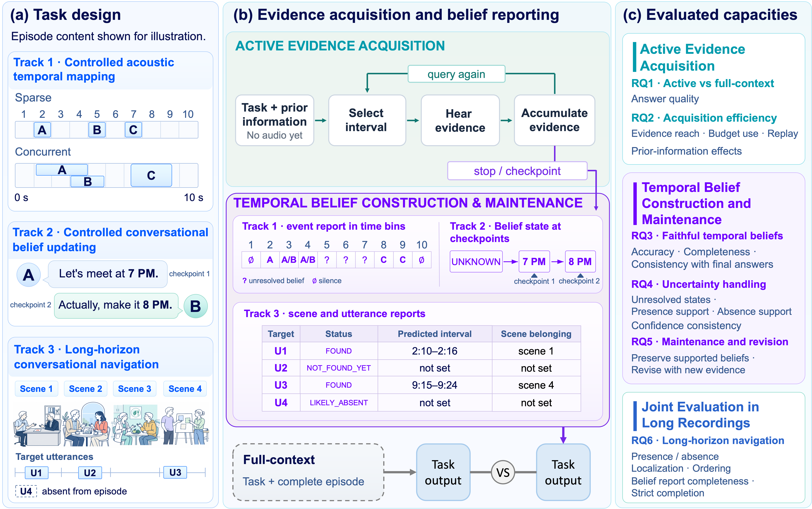

# ToT (Theory of Time)

ToT evaluates **Active Evidence Acquisition** and **Temporal Belief Construction and Maintenance** in audio-capable language models. Models choose bounded audio intervals, maintain temporal belief reports, and answer questions under listening budgets.



This repository provides the benchmark code, evaluation inputs, archived model outputs, and analysis from the reviewed submission package. It includes all 260 synthetic evaluation clips. Long-horizon source recordings are acquired separately and reconstructed using the included instructions.

**Contact:** Yuzhe Wang; [ywang792@jh.edu](mailto:ywang792@jh.edu).

**AI-generated audio:** All speech in the bundled Track 1 and Track 2 clips (internal IDs `1a`, `1b`, and `1c`) was synthesized with OpenAI `gpt-4o-mini-tts`. These voices are AI-generated, not recordings of human speakers. See the [dataset notice](generated_data/theory_of_time_v1/README.md) and [official OpenAI TTS documentation](https://developers.openai.com/api/docs/guides/text-to-speech).

## Verify the supplied materials

Run commands from this directory using Python 3.10. These checks use the Python standard library and require no model credentials or downloads:

```bash
python -B scripts/check_release.py
python -B scripts/verify_datasets.py --audio --group synthetic
```

The first command checks the package inventory and file hashes. The second verifies the frozen metadata, all 260 synthetic WAVs, and the long-horizon task definitions. See [dataset verification](docs/datasets.md) and [analysis reproduction](docs/reproduction.md) for details.

## Reproduce the reported analysis

The analysis uses archived model outputs and does not require fresh model inference, API credentials, or the long-horizon source audio. For exact figure rendering on Linux x86_64, create the pinned environment and run:

```bash
PYTHONNOUSERSITE=1 micromamba create --yes --prefix .scratch/render_env --file requirements/rendering-linux.yml
micromamba run --prefix .scratch/render_env python -s -B scripts/reproduce_paper.py
```

The command regenerates and checks 40 numerical tables and 20 figure files against the references in `analysis/expected/paper_plot_v5/`. It writes a verification report to `analysis/outputs/reproduction_report.json`. See [analysis reproduction](docs/reproduction.md) for environment requirements, input coverage, and interpretation of the checks.

## Check the benchmark implementation

For an offline check of dataset construction, model-adapter interfaces, and scoring:

```bash
python -m pip install -r requirements.txt
python scripts/smoke_test.py
python -m pip install -r requirements/test.txt
python -m unittest discover -s tests
```

The smoke test uses generated tones and a scripted dummy adapter. Its outputs are saved under `.scratch/`; its scores are not benchmark results.

For new model evaluations, follow [model setup and evaluation commands](docs/models.md). For source-audio reconstruction and dataset generation, see [datasets](docs/datasets.md).

## Track names and implementation identifiers

| Manuscript terminology | CLI/internal identifier | Included evaluation scope |
| --- | --- | --- |
| Track 1: Sparse acoustic temporal mapping | `1a` | 10 ten-second episodes |
| Track 1: Concurrent acoustic temporal mapping | `1b` | 10 ten-second episodes |
| Track 2: Conversational belief updating | `1c` | 60 conversations × 4 voice permutations = 240 episodes |
| Track 3: Long-horizon conversational navigation | `2` | Metadata for 22 recordings and 418 task instances |
| Tasks 3.1–3.5 | `2A.1`, `2A.2`, `2A.3`, `2B.1`, `2B.2` | Scene/utterance search, absence, ordering, compound navigation |

The primary scoreboard uses `active` and the `Discovery` prior for the controlled tracks. The `track2_*` implementation names refer to manuscript Track 3. See [protocol and scoring](docs/protocol.md) for the full mapping, listening budgets, session boundaries, and statistical settings.

## Repository guide

| Path | Contents |
| --- | --- |
| `tot_benchmark/`, `run_theory_of_time_benchmark.py` | Benchmark runner, adapters, and scoring |
| `configs/` | Settings for the ten evaluated models |
| `generated_data/theory_of_time_v1/` | Synthetic audio, annotations, and AI-generated audio notice |
| `track1c/`, `track2_dataset/`, `track2_human_audit/` | Dataset construction, validation, and accepted annotations |
| `artifacts/paper_results_v5.tar.gz` | Frozen model outputs used by the analysis |
| `analysis/` | Analysis notebook, plot generation, and reference outputs |
| `scripts/` | Verification, offline smoke test, reconstruction, and reproduction commands |
| `provenance/` | Input inventories, checksums, and recorded validation evidence |
| `requirements/` | Core, analysis, and adapter-specific dependency specifications |
| `tests/` | Offline benchmark and dataset tests |
